UNIVERSITÉ CHEIKH ANTA DIOP DE DAKAR

École Supérieure Polytechnique – DGI-ESP

Licence 3 Génie Logiciel et Systèmes d’Information (L3 GLSI A)

Année universitaire 2026-2027

Services Réseaux Avancés

# RAPPORT DE TP

Mise en place du protocole SSH

Sécuriser l’accès à une machine distante

Réalisé par

Moussa AW

Faye Cheikh SOW

Enseignant

Dr. GUEYE

Dakar, le 19 novembre 2026

## 1. Introduction

Le protocole SSH (Secure Shell) permet d’ouvrir une session à distance sur une machine en chiffrant toute la communication, contrairement à Telnet qui transmet les données en clair. Ce TP a pour objectif de comprendre comment utiliser SSH pour sécuriser l’accès à une machine distante.

Nous avons travaillé en quatre étapes : l’installation du serveur SSH sous Linux, la connexion depuis un client Windows, la configuration de l’authentification par clés et enfin la création d’un tunnel SSH pour faire transiter un flux HTTP.

## 2. Environnement de travail

|  | Serveur | Client |
| --- | --- | --- |
| Système | Ubuntu 22.04.5 LTS (Linux 6.8.0-90) | Windows (PowerShell) |
| Nom de la machine | baidy | tima |
| Utilisateur | baidy | fatim |
| Adresse IP | 192.168.1.25/24 (enp0s3) | Même réseau local 192.168.1.0/24 |
| Logiciel | openssh-server 1:8.9p1-3ubuntu0.18, nginx 1.18.0 | Client OpenSSH de Windows |

Le serveur dispose aussi d’une seconde interface, enp0s8 (10.0.3.15/24), qui n’est pas utilisée dans ce TP.

## 3. Installation du serveur SSH

### 3.1 Installation et activation du service

Sur la machine Linux qui joue le rôle de serveur, nous avons installé le paquet openssh-server puis activé le service au démarrage :

```bash
sudo apt install openssh-server
sudo systemctl enable ssh
```
Le paquet était déjà installé dans sa dernière version (1:8.9p1-3ubuntu0.18) ; l’activation du service au démarrage a bien été prise en compte.

*Figure 1 : Installation d’openssh-server et activation du service*
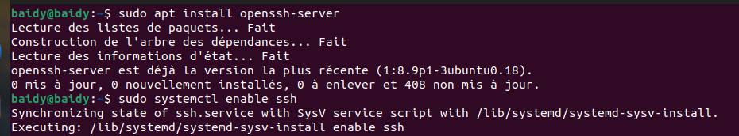

### 3.2 Démarrage et état du service

Nous avons ensuite démarré le service puis contrôlé son état avec systemctl status.

```bash
sudo systemctl start ssh
sudo systemctl status ssh --no-pager
```
Le service ssh.service est active (running) et « enabled » : il se lance donc automatiquement au démarrage. Les journaux indiquent que sshd écoute sur 0.0.0.0 port 22 (IPv4) et sur :: port 22 (IPv6).

*Figure 2 : Service ssh actif (running) et activé au démarrage*
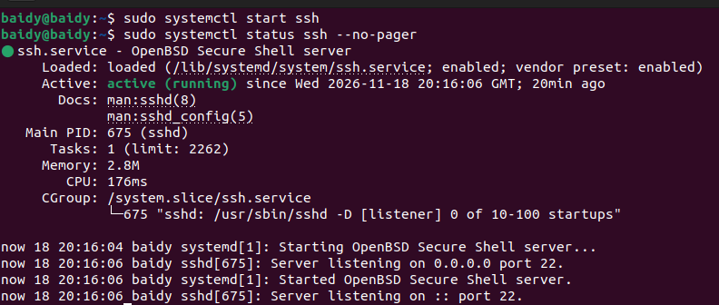

### 3.3 Vérification du port 22

Nous avons vérifié que le port 22 est bien ouvert en écoute :

```bash
ss -tlnp | grep :22
```
Deux lignes LISTEN apparaissent, l’une pour 0.0.0.0:22 (IPv4) et l’autre pour [::]:22 (IPv6) : le serveur accepte des connexions SSH sur toutes ses interfaces.

*Figure 3 : Le port 22 est en écoute en IPv4 et en IPv6*
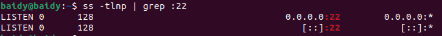

### 3.4 Adresse IP du serveur

Pour connaître l’adresse à utiliser depuis le client, nous avons affiché la configuration réseau du serveur :

```bash
ip a | grep 'inet'
```
L’interface enp0s3 porte l’adresse 192.168.1.25/24 : c’est l’adresse du serveur SSH sur le réseau local.

*Figure 4 : Adresses IP du serveur (enp0s3 : 192.168.1.25)*
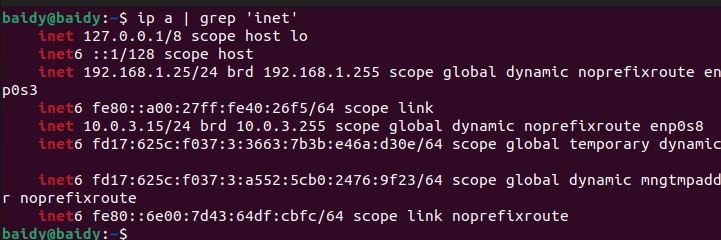

## 4. Connexion SSH depuis le client

Depuis le poste Windows, nous nous sommes connectés au serveur avec la commande ssh nom_utilisateur@adresse_ip :

```bash
ssh baidy@192.168.1.25
```
À la première connexion, le client affiche l’empreinte (fingerprint) de la clé ED25519 du serveur et demande de confirmer son authenticité. Après avoir répondu « yes », l’hôte est ajouté au fichier known_hosts du client et la session s’ouvre : le message d’accueil d’Ubuntu 22.04.5 LTS s’affiche et l’invite devient baidy@baidy.

*Figure 5 : Première connexion SSH du client Windows vers le serveur 192.168.1.25*
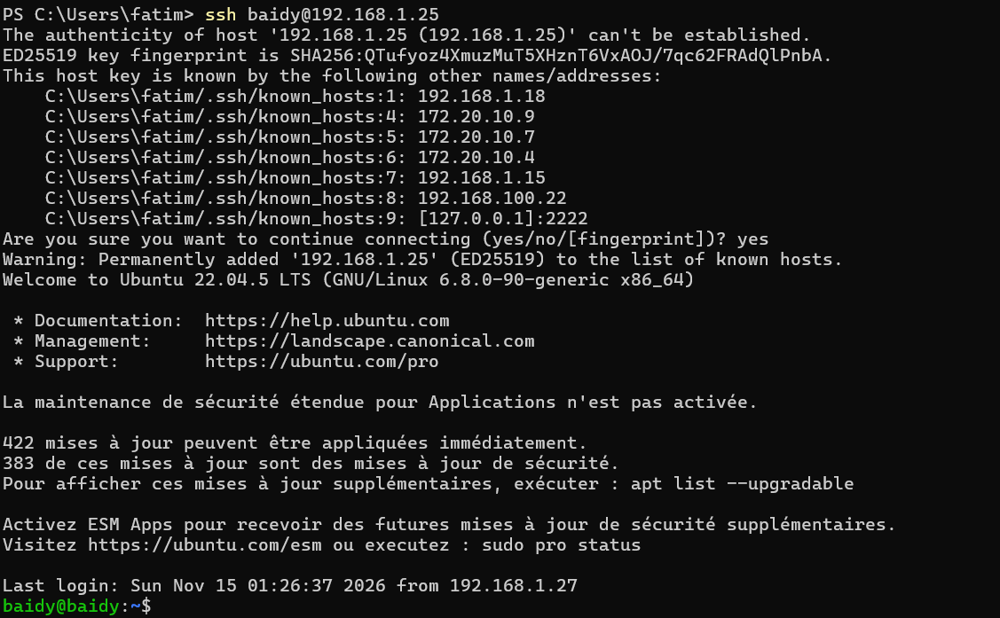

Les commandes hostname et whoami confirment que nous sommes bien connectés à la machine distante « baidy » avec l’utilisateur « baidy ».

*Figure 6 : Vérification de la session distante avec hostname et whoami*
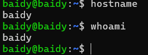

## 5. Configuration de l’authentification par clés SSH

### 5.1 Génération de la paire de clés

Nous avons généré une paire de clés ed25519 sur le poste client Windows, sans phrase secrète (passphrase vide) :

```powershell
ssh-keygen -t ed25519 -f "$env:USERPROFILE\.ssh\id_ed25519" -N '""'
```
La clé privée (id_ed25519) et la clé publique (id_ed25519.pub) sont enregistrées dans le dossier .ssh de l’utilisateur. L’empreinte de la clé est affichée avec son « randomart ».

*Figure 7 : Génération de la paire de clés ED25519 sur le client*
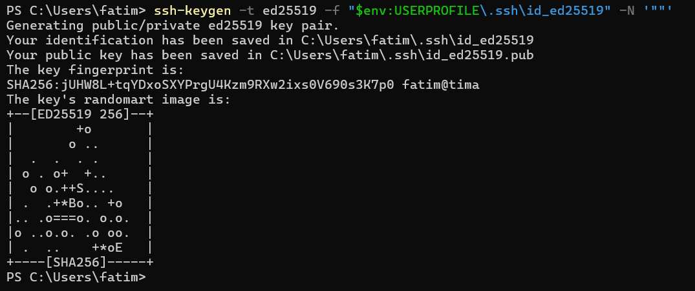

### 5.2 Vérification des fichiers et copie de la clé publique

Nous avons vérifié la présence des deux fichiers (399 octets pour la clé privée, 93 octets pour la clé publique), affiché la clé publique, puis envoyé cette dernière vers le serveur pour l’ajouter au fichier authorized_keys de l’utilisateur baidy :

```powershell
type "$env:USERPROFILE\.ssh\id_ed25519.pub" | ssh baidy@192.168.1.25 "mkdir -p ~/.ssh && chmod 700 ~/.ssh && cat >> ~/.ssh/authorized_keys && chmod 600 ~/.ssh/authorized_keys && echo CLE_INSTALLEE"
```
Le mot de passe du compte est demandé une seule fois pour cette copie, puis le message CLE_INSTALLEE confirme que la clé a été installée avec les bonnes permissions (700 sur le dossier .ssh, 600 sur authorized_keys).

*Figure 8 : Vérification des fichiers, affichage de la clé publique et installation sur le serveur*
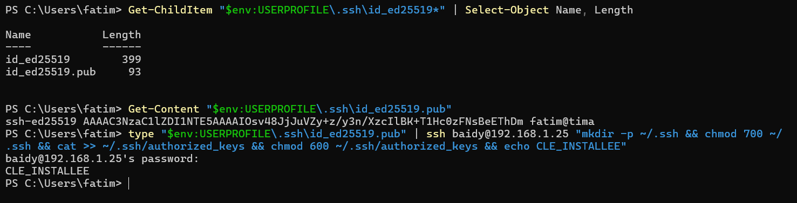

### 5.3 Contrôle côté serveur

Sur le serveur, nous avons affiché le contenu du fichier des clés autorisées :

```bash
cat ~/.ssh/authorized_keys
```
La clé publique du client, identifiable par son commentaire fatim@tima, figure bien dans le fichier. Une fois la clé en place, la connexion ssh baidy@192.168.1.25 se fait sans mot de passe.

*Figure 9 : Contenu du fichier ~/.ssh/authorized_keys sur le serveur*
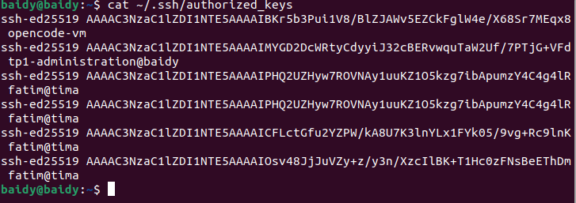

Remarque. Le TP propose de générer la paire de clés sur le serveur puis de copier la clé publique vers le client. Nous avons procédé dans l’autre sens, qui est la pratique habituelle : la clé privée reste sur la machine du client et seule la clé publique est déposée sur le serveur auquel on veut se connecter.

## 6. Tunnel SSH

### 6.1 Principe

Un tunnel SSH fait transiter un autre protocole (HTTP, FTP, MySQL…) à l’intérieur d’une connexion SSH chiffrée, à travers un seul port autorisé. Ici, le port local 1024 du client est redirigé vers le port 80 du serveur, à l’intérieur du tunnel.

### 6.2 Mise en place du serveur web

Avant de tester le tunnel, il faut un service à atteindre. Nous avons installé le serveur web nginx sur le serveur, activé son démarrage automatique, puis vérifié qu’il répond :

```bash
sudo systemctl enable --now nginx
systemctl is-active nginx
curl -I localhost
```
Le service est « active » et nginx répond « HTTP/1.1 200 OK » (serveur nginx/1.18.0 sous Ubuntu) : la page d’accueil est servie sur le port 80 du serveur.

*Figure 10 : Installation de nginx et test local avec curl -I localhost*
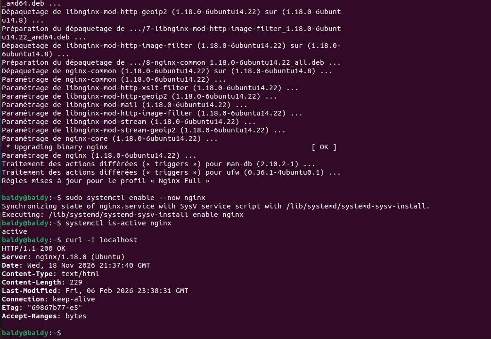

### 6.3 Création du tunnel et test

Depuis le client, le tunnel se crée avec l’option -L (redirection de port local) :

```bash
ssh -L 1024:127.0.0.1:80 baidy@192.168.1.25
```
Tant que cette session reste ouverte, le port 1024 de la machine cliente est redirigé vers le port 80 du serveur. Nous l’avons contrôlé avec Test-NetConnection 127.0.0.1 -Port 1024 : le résultat TcpTestSucceeded : True montre que le port 1024 est bien ouvert en local sur le client.

*Figure 11 : Test de connexion TCP sur le port local 1024 du client*
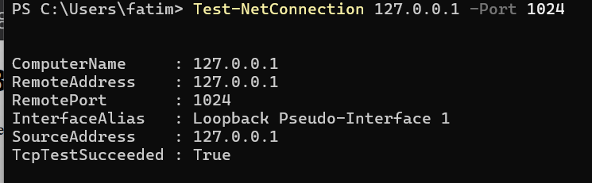

## 7. Remarques sur la sécurité

Clés autorisées : chaque ligne de authorized_keys donne un accès complet au compte baidy. Le fichier contient cinq clés distinctes (opencode-vm, tp1-administration@baidy et trois clés fatim@tima), avec une clé fatim@tima présente en double. Il est conseillé de supprimer le doublon et de retirer toute clé dont l’origine n’est pas connue.

Permissions : le dossier ~/.ssh doit rester en 700 et authorized_keys en 600, sans quoi sshd peut refuser les clés.

Passphrase : la clé privée du client a été créée sans phrase secrète. Pour un usage réel, il est préférable d’en définir une.

Authentification : une fois les clés en place, on peut désactiver l’authentification par mot de passe (PasswordAuthentication no dans sshd_config) pour limiter les attaques par force brute.

## 8. Conclusion

Ce TP nous a permis de mettre en place de bout en bout un accès SSH sécurisé : installation et vérification du serveur OpenSSH, connexion depuis un client Windows, authentification par clés ED25519 et création d’un tunnel pour atteindre un service web par un port local. Nous avons ainsi vu qu’avec SSH, un seul port (22) suffit à administrer une machine à distance et à faire transiter d’autres protocoles de manière chiffrée.
